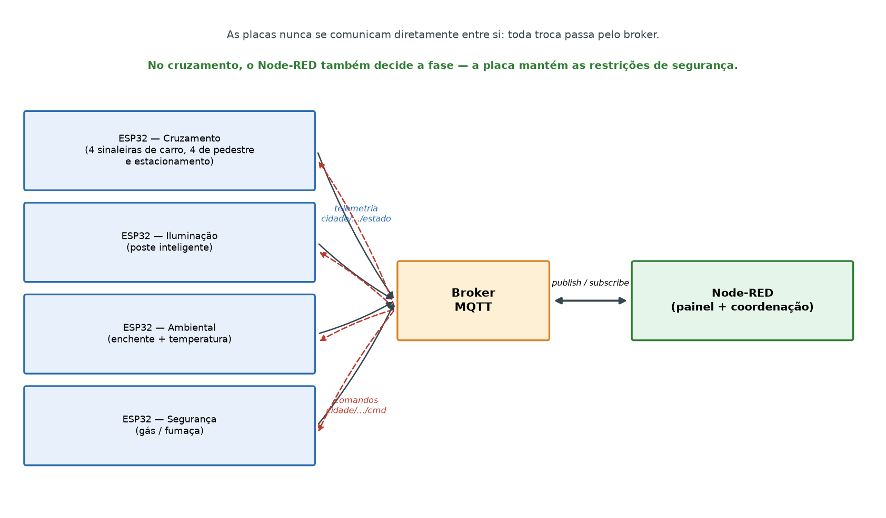

# Maquete IoT de cidade inteligente com ESP32

Maquete modular de uma cidade inteligente para ensinar **Internet das Coisas** em sala
de aula. Cinco placas **ESP32** controlam seis serviços urbanos — cruzamento com
semáforos e botoeiras, estacionamento, iluminação pública, alerta de enchente,
temperatura e umidade, e detecção de gás e fumaça — e conversam por **MQTT** com um
painel no **Node-RED**, de onde se acompanha e se comanda a cidade.

Este repositório traz o que um professor precisa para montar, operar e usar a maquete
com uma turma: firmware, painel, configuração do broker, esquemáticos, desenhos de
montagem, passo a passo com testes e uma atividade pronta, com roteiro, questionários e
critérios de correção. O projeto foi desenvolvido no Trabalho de Conclusão de Curso de
Engenharia de Computação de Bruno Coelho, na Universidade Feevale (2026), sob orientação
do Prof. Me. Vandersilvio da Silva.

## Começo rápido

1. **Instale os programas:** Arduino IDE com o pacote ESP32, o broker Mosquitto e o
   Node-RED com o dashboard. Tudo em [INSTALACAO.md](INSTALACAO.md).
2. **Suba o broker** em qualquer computador da rede (Windows, Linux, macOS ou
   Raspberry Pi) e anote o IP dele. Veja a seção [Broker](#broker).
3. **Configure as placas:** em cada pasta `node_*`, copie `secrets.example.h` para
   `secrets.h` e preencha a rede Wi-Fi e o IP do broker. Grave cada sketch na sua placa.
4. **Recrie o painel:** importe o [`flows.json`](flows.json) no Node-RED e abra
   `http://<ip-do-node-red>:1880/ui`.
5. **Aplique a atividade:** roteiro, questionários e guia do professor em
   [atividade/](atividade/README.md).

## O que tem aqui

| Pasta ou arquivo | Conteúdo |
|---|---|
| `node_sinaleiras/`, `node_sensores/`, `node_iluminacao/`, `node_ambiental/`, `node_seguranca/` | firmware das cinco placas |
| [`flows.json`](flows.json) | painel e lógica do Node-RED, incluindo a coordenação do cruzamento |
| [`broker.cmd`](broker.cmd) e [`mosquitto.conf`](mosquitto.conf) | broker MQTT pronto para Windows e para qualquer outro sistema |
| [`bancada/`](bancada/README.md) | sketches de teste, sem rede, para montar uma placa por etapas |
| [`PASSO_A_PASSO.md`](PASSO_A_PASSO.md) | montagem em etapas, com um teste que prova cada uma antes de seguir |
| [`MATERIAIS.md`](MATERIAIS.md) e [`layout/`](layout/) | material de cada placa e desenho de cada protoboard |
| [`esquematicos/`](esquematicos/README.md) | esquemáticos elétricos, em KiCad e PDF |
| [`atividade/`](atividade/README.md) | atividade de aula: módulo novo (ponto de ônibus), roteiro, questionários, guia e gabarito |

## Placas e sistemas

| Placa | Sketch | Sistemas |
|-------|--------|----------|
| 1A — Sinaleiras | `node_sinaleiras/` | Todos os focos do cruzamento (4 cabeças de veículo + 4 de pedestre) e a máquina de fases |
| 1B — Sensores | `node_sensores/` | Aproximação nas 4 vias, 3 vagas de estacionamento e 4 botoeiras |
| 2 — Iluminação | `node_iluminacao/` | Poste Inteligente (LDR + presença fundidos) |
| 3 — Ambiental  | `node_ambiental/`  | Alerta de enchente + estação de temperatura e umidade |
| 4 — Segurança  | `node_seguranca/`  | Detector de gás/fumaça (incêndio) |

> **Por que o cruzamento são duas placas.** Sem os 74HC595 ele não cabe num ESP32 (14 canais
> de foco + 11 entradas contra ~20 pinos). O corte é por **função**, não por via, para que o
> invariante de segurança — nunca dois verdes conflitantes — caiba inteiro dentro de um
> microcontrolador. A placa 1B não aciona foco nenhum: se ela cair, o cruzamento perde
> eficiência e segue seguro no ciclo de tempo fixo.

---

## Mapa de GPIO (ajuste ao seu devkit)

Regras ESP32 respeitadas: analógico só na **ADC1 (GPIO 32–39)** por causa do WiFi;
pinos **34–39** apenas como entrada e **sem pull-up interno**; evitados flash (6–11),
strapping (0/2/12/15) e UART0 (1/3).

### Placa 1A — Sinaleiras (`node_sinaleiras`) — só saídas
| Função | GPIO |
|---|---|
| Via A (Norte+Sul) vermelho / amarelo / verde | 23 / 22 / 21 |
| Via B (Leste+Oeste) vermelho / amarelo / verde | 19 / 18 / 17 |
| Pedestre **N** vermelho / verde | 16 / 4 |
| Pedestre **S** vermelho / verde | 5 / 13 |
| Pedestre **L** vermelho / verde | 14 / 27 |
| Pedestre **O** vermelho / verde | 26 / 25 |
| Buzzer (travessia sonora) | 33 |

> As duas cabeças de uma via dividem o mesmo pino porque **sempre mostraram o mesmo
> aspecto**, em todas as fases. Os módulos usados já trazem resistor em cada entrada de cor. Livre: GPIO 32.
>
> O **buzzer da travessia** é item de acessibilidade: apita na fase de pedestre e acelera no
> intermitente, e é a indicação da travessia para quem não vê o foco.
>
> As cabeças de veículo são **módulos de mini sinaleira**, não LEDs soltos. O pino **comum**
> do módulo define o nível que acende: comum no GND acende com `HIGH` (`ACESO = HIGH`, como
> está), comum no 3,3 V acende com `LOW`. Trocar de módulo é trocar essa constante.

### Placa 1B — Sensores (`node_sensores`) — só entradas
| Função | GPIO |
|---|---|
| IR de aproximação N / S / L / O | 34 / 35 / 36 / 39 (só entrada) |
| IR de vaga 1 / 2 / 3 | 32 / 33 / 25 |
| Botoeiras N / S / L / O | 17 / 21 / 18 / 19 (`INPUT_PULLUP`) |

> Os detectores IR podem ficar em 34–39 porque o módulo traz o próprio pull-up. As
> botoeiras não podem: usam o pull-up interno do ESP32 e exigem GPIO comum.

### Placa 2 — Iluminação (`node_iluminacao`)
| Função | GPIO |
|---|---|
| LDR | 32 (ADC1) |
| TCRT5000 (`DO`) | 33 |
| LED (PWM) | 25 |

> Em **AUTO** o poste acende com as **duas** condições satisfeitas: escuro (LDR abaixo do
> `limiar`) **e** presença. Só escuro, ou só presença, e ele fica apagado. A presença vale
> por 5 s depois da última detecção — o TCRT5000 não segura nada sozinho, e sem essa
> retenção o poste apagaria no instante em que o objeto saísse de cima do sensor.
> Iluminação pública real não apaga entre um pedestre e outro: ela cai para uma base e sobe
> quando alguém passa. Para ter esse comportamento, basta trocar `brilhoBase` de `0` para
> `80` no firmware; a lógica é a mesma nos dois casos.
>
> O sensor é o **oitavo TCRT5000**, o mesmo módulo dos sete da placa 1B. Ele fica embutido no
> piso ao lado do poste, virado para cima: é de reflexão e enxerga milímetros, então a placa
> detecta *o veículo passando naquele ponto*, não alguém se aproximando de longe.

### Placa 3 — Ambiental (`node_ambiental`)
| Função | GPIO |
|---|---|
| Sensor de nível de água (analógico) | 35 (ADC1) |
| LED nível verde / amarelo / laranja / vermelho | 19 / 21 / 22 / 23 |
| Buzzer | 13 |
| Servo (comporta) | 25 |
| DHT22 (temperatura e umidade) | 4 |
| LED temp verde / amarelo / vermelho | 26 / 27 / 14 |

### Placa 4 — Segurança (`node_seguranca`)
| Função | GPIO |
|---|---|
| MQ-2 (saída analógica AO, via divisor 1:2) | 34 (ADC1) |
| LED verde / amarelo / vermelho | 25 / 26 / 27 |
| Buzzer / sirene | 13 |

> **MQ-2**: o aquecedor exige **5V** e a saída **AO** pode chegar perto disso, então passa por
> um **divisor 1:2** (1 kΩ / 2 kΩ) antes do GPIO 34. É o único divisor que restou no projeto.
> O sensor precisa de **pré-aquecimento (~20 s)** — o firmware fica em `AQUECENDO` nesse
> período. Calibre `limiarAlerta`/`limiarPerigo` observando o valor em ar limpo.
> Se a leitura ficar abaixo de `limiarFalha` (50) por 3 s, a placa entra em `FALHA`
> (sensor desconectado): bipe grave de 400 Hz, 1 s a cada 5 s, e LEDs amarelo e vermelho
> piscando. Para testar, solte o fio do AO com a placa aquecida. Se o seu MQ-2 ler menos
> que 50 em ar limpo, baixe o limite com `{"limiarFalha":N}` em `cidade/seguranca/cmd`.

> **Módulos TCRT5000**: alimente em **3,3 V**. A saída acompanha a alimentação, e em 5 V
> levaria 5 V ao GPIO. Saída em nível **baixo** com obstáculo (constante `NIVEL_DETECTADO`).

> **Alimentação de sensores analógicos**: LDR e sensor de nível em **3,3 V**, nunca 5 V —
> o ADC do ESP32 é 0–3,3 V e as fórmulas dos sketches assumem 12 bits sobre 3,3 V.

## Contrato MQTT

Telemetria em **JSON**; comandos no subtópico `/cmd`.

| Sistema | Telemetria (ESP32 → dashboard) | Comando (dashboard → ESP32) |
|---|---|---|
| Enchente | `cidade/enchente/estado` → `{"nivel":42,"estado":"ATENCAO"}` — `nivel` é **% de submersão** (mais = pior) | `cidade/enchente/cmd` → `SIMULAR` \| `RESET` |
| Temperatura | `cidade/temperatura/estado` → `{"temp":24.5,"umidade":58.4,"status":"OK"}` | — |
| Estacionamento | `cidade/estacionamento/estado` → `{"livres":2,"vagas":[1,0,1]}` | — |
| Iluminação | `cidade/iluminacao/estado` → `{"ldr":1200,"presenca":true,"brilho":255,"modo":"AUTO","limiar":1000}` | `cidade/iluminacao/cmd` → `{"modo":"ON\|OFF\|AUTO"}` e/ou `{"limiar":800}` |
| Cruzamento (placa 1A) | `cidade/cruzamento/estado` → `{"fase":"VIA_A","destino":"VIA_A","t_fase":5200,"supervisionado":true,"pedidos":[0,1,0,0],"servindo":[0,0,0,0]}` | `cidade/cruzamento/cmd` → `{"fase":"VIA_A"\|"VIA_B"\|"PEDESTRES"}`, `{"pedestre":0..3}`, `PISCANTE` \| `NORMAL` |
| Sensores do cruzamento (placa 1B) | `cidade/cruzamento/sensores` → `{"carros":[1,0,1,1],"fluxo":[3,0,2,1],"livres":2}` · `cidade/cruzamento/botoeira` → `{"j":2}` (evento, um por aperto) | — |
| Segurança | `cidade/seguranca/estado` → `{"gas":420,"estado":"NORMAL","silenciado":false}` | `cidade/seguranca/cmd` → `SILENCIAR` \| `REARMAR` e/ou `{"limiarAlerta":1500,"limiarPerigo":2500}` |

Para criar um sistema novo, siga o mesmo formato: telemetria em `cidade/<sistema>/estado`,
comandos em `cidade/<sistema>/cmd` e `cidade/<sistema>/status` com *last will*, para o
painel saber se a placa está *online*. Nenhuma placa existente precisa ser alterada.

---

## Broker

O broker é o "correio" do MQTT: as placas e o painel só falam com ele. Ele pode rodar
**em qualquer computador da mesma rede**: o notebook do professor, um computador fixo do
laboratório ou uma Raspberry Pi dedicada. A única exigência é que as placas saibam o IP
dele (`MQTT_HOST` no `secrets.h`).

- **Windows:** dê duplo clique em [`broker.cmd`](broker.cmd). Ele sobe o Mosquitto já
  configurado, mostra o IP desta máquina e confere se ele bate com o `MQTT_HOST` do
  `secrets.h`. Deixe a janela aberta: fechá-la derruba o broker.
- **Linux, macOS ou Raspberry Pi:** `mosquitto -c mosquitto.conf -v`, com o
  [`mosquitto.conf`](mosquitto.conf) deste repositório. Para deixar o broker sempre ligado
  numa Raspberry Pi, veja [INSTALACAO.md](INSTALACAO.md#broker-fixo-numa-raspberry-pi).

> **Por que um arquivo de configuração.** O Mosquitto 2.x iniciado sem configuração aceita
> conexões só do próprio computador. O broker parece funcionar, um teste local responde, e
> as placas levam "conexão recusada" sem nenhuma pista no firmware.

**Se o broker cair**, cada placa continua funcionando sozinha: o cruzamento, sem comando
por 10 s, volta ao ciclo de tempo fixo; enchente, iluminação e segurança seguem com a
lógica local. Perde-se a coordenação e o painel, não a segurança. Numa instalação fixa,
vale deixar o broker numa máquina dedicada.

## Node-RED

1. Instale o Node-RED e o `node-red-dashboard` ([INSTALACAO.md](INSTALACAO.md#node-red)).
2. Importe o [`flows.json`](flows.json): menu ☰ → *Import* → selecione o arquivo →
   *Import* → *Deploy*.
3. Abra o nó de configuração **broker1** (qualquer nó MQTT → lápis ao lado de *Server*).
   Se o Node-RED roda no mesmo computador do broker, deixe `localhost`; se não, troque
   pelo IP do broker. O nó deve ficar **connected**.
4. Abra o painel em `http://<ip-do-node-red>:1880/ui`.

### O flow de coordenação do cruzamento

É onde mora a otimização de tráfego. O nó **`coordenacao adaptativa`** decide a fase a
partir das **duas** metades da telemetria: `cidade/cruzamento/estado` (placa 1A — fase,
`t_fase`, pedidos) e `cidade/cruzamento/sensores` (placa 1B — carros, fluxo). O nó
`sensores do cruzamento` guarda a última leitura da 1B com a hora; a decisão roda no ritmo
da 1A, porque é o `t_fase` dela que manda:

| Situação | Decisão |
|---|---|
| Outra via sem fila e ninguém na botoeira | **retém** o verde — não para o trânsito à toa |
| Detector livre há **2,5 s** contínuos | encerra o verde (intervalo de folga) |
| Verde há mais de 15 s | encerra (teto de justiça) |
| Fim natural da fase, com pedestre pedido | serve a `PEDESTRES` |
| Pedestre esperando há mais de **12 s** | `PEDESTRES` com prioridade absoluta |
| Depois da travessia | abre a via com maior taxa de chegada recente |

**Por que a folga de 2,5 s.** Trocar de fase custa 3,5 s em que ninguém anda (amarelo 2 s +
entreverdes 1,5 s). O detector fica livre entre dois carros do mesmo pelotão; encerrar o
verde nesse claro troca de fase, gasta os 3,5 s e o carro seguinte chega no vermelho. O
verde só termina após **ausência contínua** — é a regra clássica do controle atuado
(MBST vol. V, cap. 8).

**Por que o pedestre não preempta.** Uma botoeira apertada logo após o verde abrir forçaria
troca (3,5 s) + travessia (9 s) = 12,5 s de trânsito parado. Ele é servido no encerramento
natural da fase, e passa à frente só se já esperou 12 s — espera limitada sem penalizar o
fluxo.

> **Teto que não é de software:** com um detector de presença por aproximação, o sistema não
> distingue 1 carro de 10. Alocação proporcional à fila exigiria um segundo detector a
> montante de cada via — é o próximo passo de hardware, não de algoritmo.

> **A placa é quem garante a segurança**, não o flow: verde mínimo, amarelo, entreverdes
> e tempo de travessia fixo são impostos no firmware, e o Node-RED só escolhe entre fases
> de uma lista fechada. Nenhum comando — nem errado, nem em rajada — produz combinação
> insegura.

O flow reenvia a fase atual a cada 4 s como **keepalive**: sem comando por 10 s, a placa
conclui que perdeu o Node-RED e volta ao ciclo de tempo fixo dela (o painel mostra
*"placa no ciclo local"*). Os botões de fase assumem o controle manual; **Automático**
devolve a decisão ao coordenador.

**Se a placa de sensores calar**, o coordenador para de comandar depois de 5 s sem leitura
nova — e o keepalive para junto, então em 10 s a 1A reassume o ciclo local. Parece
desistência e é o contrário: insistir com `carros` zerado acionaria a regra "ninguém
esperando", que **retém** o verde, e o cruzamento congelaria numa fase só. O painel troca
as filas por *"sensores mudos"*. Em modo Manual nada disso se aplica — ali quem decide é o
operador, que não depende de detector.

**A botoeira física** sai da placa 1B como evento (`cidade/cruzamento/botoeira` → `{"j":2}`)
e o nó `botoeira fisica` a traduz em `{"pedestre":2}`, o mesmo comando da botoeira virtual
do painel. É evento e não estado porque a 1B não tem como saber quando a travessia foi
atendida: quem zera o pedido é a máquina de fases, do outro lado. Com o Node-RED fora do
ar, o botão físico não chega na 1A — a travessia só sai pelo ciclo local.

---

## Verificação ponta a ponta

1. **Compilar** cada sketch na Arduino IDE (placa: *ESP32 Dev Module*).
   Via CLI: `arduino-cli compile --fqbn esp32:esp32:esp32 node_iluminacao`.
2. **Broker**: com o Mosquitto rodando, observe a telemetria:
   `mosquitto_sub -h <IP> -t 'cidade/#' -v`
3. **Comando manual** (sem o dashboard):
   `mosquitto_pub -h <IP> -t 'cidade/iluminacao/cmd' -m '{"modo":"ON"}'`
   `mosquitto_pub -h <IP> -t 'cidade/enchente/cmd' -m 'SIMULAR'`
4. **Serial Monitor** (115200): confirme `WiFi` conectado, IP, e `Conectando MQTT... ok`.
5. **Dashboard**: gauges reagindo à telemetria e botões/switches publicando comandos
   (confirme no `mosquitto_sub`).

---

## Segurança e rede

- O MQTT da maquete roda em rede local, **sem usuário, senha ou cifragem**. Isso é
  adequado a um laboratório, não a uma instalação aberta; numa implantação real,
  acrescente TLS e um usuário por placa no Mosquitto.
- O ESP32 só conecta em rede **2,4 GHz** com senha compartilhada (WPA2-Personal). Redes
  institucionais como a eduroam (WPA2-Enterprise) não servem; use o hotspot do celular
  ou um roteador próprio na aula.
- O `secrets.h` de cada placa guarda a senha da rede e **não deve ir para o
  repositório**. Ele já está no `.gitignore`.

## Licença

Código sob licença [MIT](LICENSE). Documentos e figuras podem ser usados e adaptados
para fins educacionais, citando a fonte.
